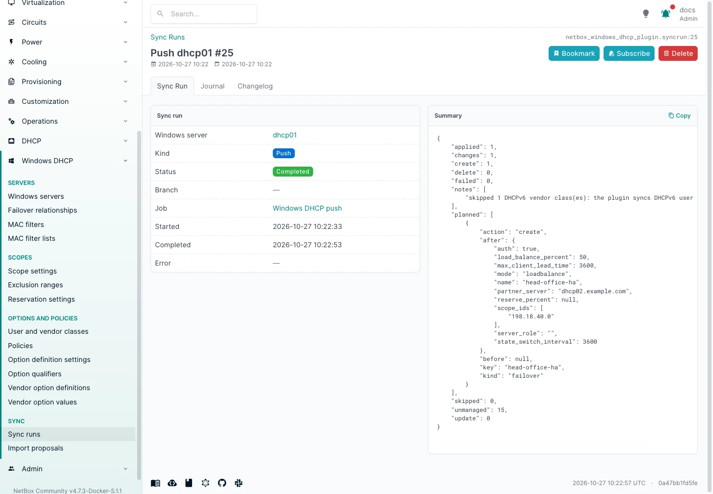
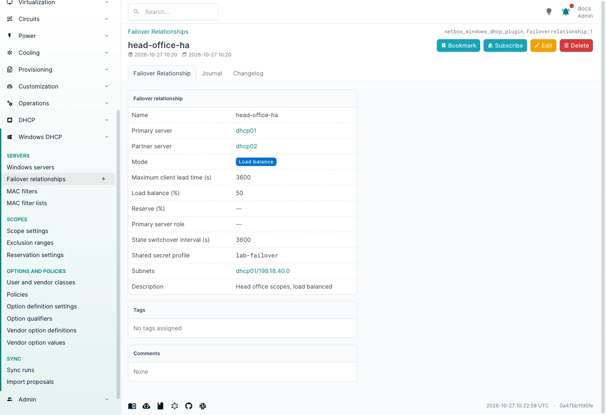

# Failover

Windows DHCP failover pairs two servers that share IPv4 scopes, in **load balance** or **hot standby** mode. Changes
are made on one partner and replicated to the other.

## The model

A **Failover relationship** (**Windows DHCP > Failover relationships**) holds:

| Field | Meaning |
|---|---|
| Name | The relationship name on Windows (compared without case) |
| Primary server | The sys4 DHCP server changes are written to, then replicated from |
| Partner server | The other sys4 DHCP server |
| Mode | Load balance or hot standby |
| Maximum client lead time | Seconds (MCLT) |
| Load balance (%) | Load balance mode only: the primary's share |
| Reserve (%) | Hot standby mode only: addresses kept for the standby |
| Primary server role | Hot standby mode only: active or standby |
| State switchover interval | Seconds before switching to partner-down automatically; empty disables it |
| Shared secret profile | Credential profile holding the message authentication secret; empty leaves authentication as Windows has it |
| Subnets | The scopes the relationship covers |

"Primary" here is the plugin's word for the partner it writes to. It is not the Windows server role (active or
standby).

Give both partners a Windows server in NetBox. A partner name on Windows matches a Windows server by its host (its
`computer_name` when it is reached through a management host, else its `host`), or by one of its **Reported names**,
the computer name, DNS name and addresses the server gave on its last connection test, import or push (changing
the host or computer name clears them). Short and fully qualified
names match. A push gives Windows the partner's host as NetBox holds it, so that name must resolve on the primary
DHCP server too, not only on NetBox (otherwise `Add-DhcpServerv4Failover` fails with "Failed to verify if a failover
relationship ... exists on server ...").

## Connecting to the servers

Creating or changing a relationship, adding or removing its scopes, and replication make the server you connect to
call its partner as your account. Windows only lets it do that when it holds your credentials, so give both
partners' Windows servers in NetBox **WinRM authentication: CredSSP**, and enable CredSSP on each DHCP server:

```powershell
Enable-WSManCredSSP -Role Server -Force
```

Over NTLM or Kerberos (without constrained delegation) those cmdlets fail with `PermissionDenied`, for example
`Failed to verify if a failover relationship by the name ... exists on server ...`. Reading relationships works with
any method. Both partners must accept the account: in a workgroup, the same local account with the same password on
both. CredSSP hands the password to the DHCP server, so it needs **WinRM over HTTPS** with **Verify host** on;
`allow_insecure_credssp` on the credential profile lifts that for a lab (see [Security](security.md#transport)).

**SSH with a password** works too: Windows OpenSSH logs a password user on with credentials it can pass on, so the
failover tests passed over SSH as over CredSSP (lab, Windows Server 2022). SSH key authentication was not tried.


## How it syncs

- **Import** cannot tell which partner should be the primary: the first partner imported becomes it. **Import the
  server you want to write to first.** After that, the partner's imports and pushes leave the relationship alone, and
  applying it from the partner is refused while NetBox holds it with the other server as primary.
- **Push** writes relationships, and the scopes in them, to the primary only. After a push to the primary, the scopes
  it changed are replicated to the partner with `Invoke-DhcpServerv4FailoverReplication -ScopeId` (all the
  relationship's scopes when a server-level object such as an option definition changed). Only scopes Windows already
  has in the relationship are replicated; one that is not yet (its addition failed) waits, so it cannot block the
  others. If replication fails, the push is marked failed. Either way the next push to the primary replicates those
  scopes again, even when it has nothing else to write: run **Sync now** on the primary once the cause is fixed.
- A push to the partner server leaves the relationship's scopes alone: they belong to the primary.
- **Primary server role** is set when the relationship is created. Windows cannot change it afterwards
  (`Set-DhcpServerv4Failover` has no role parameter), so a push that changes it in NetBox is refused. To change it,
  delete the relationship in NetBox and let that push finish, then create it again with the new role: a delete and
  a create of the same name in one push (or one branch merge) count as a change, and are refused. Switching a
  relationship from load balance to hot standby lets Windows pick the roles; if it picks another role than NetBox
  holds, the rest of the change is still made, and the push asks you to set that role in NetBox or import the
  server.

So edit failover scopes as scopes of the primary server in NetBox; the partner's copies follow through replication.

Saving the relationship queues a push to the primary, which creates it on both servers:





## Shared secret

With message authentication, put the secret in a credential profile and name it in **Shared secret profile**:

```python
PLUGINS_CONFIG = {
    "netbox_windows_dhcp_plugin": {
        "credentials": {
            "failover-secret": {
                "secret_env": "DHCP_FAILOVER_SECRET",
                "allowed_hosts": ["dhcp1.corp.example", "dhcp2.corp.example"],
            },
        },
    },
}
```

The secret goes to both servers, so `allowed_hosts` must cover both partners; it is checked when the relationship is
saved and again whenever a push sends the secret. It is read from the profile only when a push needs it, goes
straight to the cmdlet, and is never stored or logged. NetBox only records whether authentication is on, so a secret rotated on
Windows is not noticed. Without a profile, NetBox does not manage authentication at all: an imported relationship
keeps whatever Windows has (an import cannot read the secret), and pushes leave it alone. Set a profile to turn
authentication on or to send a new secret.

## Scopes joining and leaving

- A scope added to a managed relationship's subnets is added to it on Windows.
- A scope removed from the relationship leaves it, which removes the scope from the partner (as Windows does).
  The plugin only does that for a relationship it manages, unchanged on Windows since the last push, and never for a
  scope NetBox does not manage.
- A scope deleted in NetBox leaves its relationship first, in the same push, after a lease check: a scope with leases
  is refused before anything changes.
- Removing a relationship removes its scopes from the partner, as Windows documents.

Changing the partner is refused: Windows only allows it by removing the
relationship.

A relationship can be left with no scopes: Windows keeps it, empty, on both partners.

While the partner cannot be reached, Windows refuses to remove the relationship or one of its scopes ("not in
NORMAL state"), and so does the push: removing it on one side only would leave the other partner serving the scope
on its own. Bring the partner back and push again.

!!! tip "Partners known by IP address"
    Windows names the partner as it was given when the relationship was created on one side, and by its computer
    name on the other side. Through the servers' reported names, a computer name matches a server NetBox knows by IP
    address, and an address matches one it knows by name, so run **Test connection** on both Windows servers before
    the first import. Two servers reporting the
    same name match neither: give one of them that name as host.
