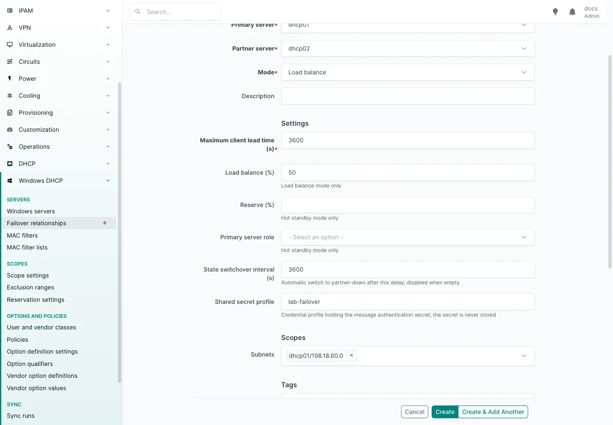
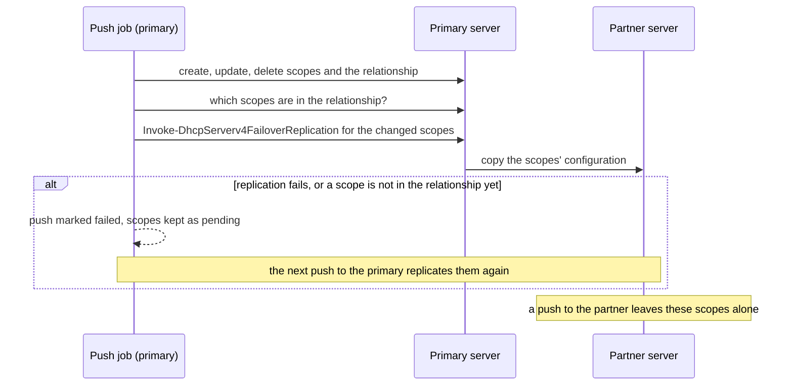

# Failover

Windows DHCP failover pairs two servers that share IPv4 scopes, in **load balance** or **hot standby** mode. Changes
are made on one partner and replicated to the other.

## The model

A **Failover relationship** (**Windows DHCP > Failover relationships**) holds:

| Field | Meaning |
|---|---|
| Name | The relationship name on Windows (compared without case) |
| Primary server | The Windows server changes are written to, then replicated from |
| Partner server | The other Windows server |
| Mode | Load balance or hot standby |
| Maximum client lead time | Seconds (MCLT) |
| Load balance (%) | Load balance mode only: the primary's share |
| Reserve (%) | Hot standby mode only: addresses kept for the standby |
| Primary server role | Hot standby mode only: active or standby |
| State switchover interval | Seconds before switching to partner-down automatically; empty disables it |
| Shared secret profile | Credential profile holding the message authentication secret; empty leaves authentication as Windows has it |
| Scopes | The IPv4 scopes of the primary server the relationship covers |

"Primary" here is the plugin's word for the partner it writes to. It is not the Windows server role (active or
standby).

Give both partners a Windows server in NetBox. A partner name on Windows matches a Windows server by its host (its
`computer_name` when it is reached through a management host, else its `host`), or by one of its **Reported names**,
the computer name, DNS name and addresses the server gave on its last connection test, import or push (changing
the host or computer name clears them). Short and fully qualified
names match. A push gives Windows the partner's host as NetBox holds it, so that name must resolve on the primary
DHCP server too, not only on NetBox (otherwise `Add-DhcpServerv4Failover` fails with "Failed to verify if a failover
relationship ... exists on server ...").

## Connecting to the servers

Creating or changing a relationship, adding or removing its scopes, and replication make the server you connect to
call its partner as your account. Windows only lets it do that when it holds your credentials, so give both
partners' Windows servers in NetBox CredSSP, in one of two ways:

- **Failover authentication: CredSSP**, with any **WinRM authentication** (Kerberos, say): the plugin logs on with
  CredSSP for the failover writes and replication only, and as usual for everything else. Use it when CredSSP should
  only be used where it is needed;
- or **WinRM authentication: CredSSP**, for every call.

With a Kerberos credential profile whose user name has no domain, the CredSSP logon adds the server's **Kerberos
realm** (`user@REALM`). **Test connection** checks both logons. If the CredSSP connection fails (or times out), a push still sends
everything else and fails only what goes through it: the failover changes, the removal of a deleted scope from its
relationship, and the replication, which the next push tries again.

Either way, enable CredSSP on each DHCP server:

```powershell
Enable-WSManCredSSP -Role Server -Force
```

Over NTLM or Kerberos those cmdlets fail with `PermissionDenied`, for example
`Failed to verify if a failover relationship by the name ... exists on server ...`. Kerberos delegation does not
help: in a domain lab (Windows Server 2025, resource-based constrained delegation between the two servers, the only
kind tried) a Kerberos session on one server could open a share on its partner, but the DHCP calls to the partner
went out as an anonymous NTLM logon and were refused. Reading relationships works with any method. Both partners
must accept the account: in a workgroup, the same local account with the same password on both. CredSSP hands the password to the DHCP server, so it needs **WinRM over HTTPS** with **Verify host** on;
`allow_insecure_credssp` on the credential profile lifts that for a lab (see [Security](security.md#transport)); a
shared secret profile used with that server must set it too, since the secret travels over the same connection.

**SSH with a password** works too: Windows OpenSSH logs a password user on with credentials it can pass on, so the
failover tests passed over SSH as over CredSSP (lab, Windows Server 2022). **SSH with a private key** does not: a key
logon holds no password to pass on, so failover writes fail with `PermissionDenied` (lab, Windows Server 2025, domain
account). Give failover servers a credential profile with a password.

## A working failover, step by step

This walkthrough pairs two servers in load balance mode and shows the result on both. It was run on a lab: NetBox
without branching, two Windows Server 2025 DHCP servers in a workgroup (computer names `DHCP01` and `DHCP02`),
known to NetBox as `dhcp01.example.com` and `dhcp02.example.com`, WinRM with CredSSP, sync enabled on both. The
reservation page follows the same lab: [Reservations](reservations.md).

### 1. Prepare

- Both servers have a Windows server in NetBox with **WinRM authentication: CredSSP**, or **Failover
  authentication: CredSSP** next to another WinRM authentication (or SSH with a password), and **Test connection**
  completes on both. The test also records each server's reported names, which the plugin
  uses to recognise the partner later.
- The primary DHCP server resolves the partner's host as NetBox holds it. Here both servers' hosts files map
  `dhcp01.example.com` and `dhcp02.example.com`; in a domain, DNS does it.
- The scopes to share exist on the primary and are pushed: here `198.18.60.0/24` with the reservation `printer01`.
  The partner does not need them; Windows copies them there when the relationship is created.
- The primary server's credential profile covers the partner in its `allowed_hosts`, when it has the list: creating
  the relationship makes the primary contact the partner as that account, and the push refuses to create it
  otherwise. The form already refuses a new partner the profile does not cover (an imported relationship, or one whose
  primary and partner did not change, is not checked again: Windows already has it).
- For message authentication, a credential profile holds the shared secret and its `allowed_hosts` cover both
  partners (here `lab-failover`, see [Shared secret](#shared-secret)).

### 2. Create the relationship in NetBox

**Windows DHCP > Failover relationships > Add**: a name, the primary server (the one NetBox writes to), the partner,
the mode and its settings.


Further down, the shared secret profile and the scopes the relationship covers:



### 3. The push

Saving queues a push to the primary, which creates the relationship on Windows with its scope. Windows sets it up
on the partner itself:


A push also runs for the partner, since the relationship touches it. It changes nothing there and says why:
`skipped 1 failover relationship(s) whose primary is another server: they are synced from that server`.


### 4. Check on Windows

On the primary, the scope's **Properties > Failover** tab names the relationship and the partner, and both servers
are in state Normal:


On the partner, the same scope now exists, with the same tab. The partner names the primary by its computer name,
`DHCP01`, which is why the plugin matches partners on reported names (see the tip at the end of this page):


The same in PowerShell, on each server:

```text
PS> Get-DhcpServerv4Failover | Format-List        # on DHCP01

Name                : dhcp01-dhcp02
PartnerServer       : dhcp02.example.com
Mode                : LoadBalance
LoadBalancePercent  : 50
ServerRole          :
ReservePercent      :
MaxClientLeadTime   : 01:00:00
StateSwitchInterval : 01:00:00
State               : Normal
ScopeId             : 198.18.60.0
AutoStateTransition : True
EnableAuth          : True
```

```text
PS> Get-DhcpServerv4Failover | Format-List        # on DHCP02

Name                : dhcp01-dhcp02
PartnerServer       : DHCP01
Mode                : LoadBalance
LoadBalancePercent  : 50
ServerRole          :
ReservePercent      :
MaxClientLeadTime   : 01:00:00
StateSwitchInterval : 01:00:00
State               : Normal
ScopeId             : 198.18.60.0
AutoStateTransition : True
EnableAuth          : True
```

### 5. Changes replicate

From now on, edit the scope on the primary in NetBox. A new reservation, `scanner01` at `198.18.60.22`, saved on the
scope `dhcp01/198.18.60.0`, was pushed to DHCP01 and the scope replicated to DHCP02 in the same job:


DHCP02 has both reservations without NetBox writing to it:


```text
PS> Get-DhcpServerv4Reservation -ScopeId 198.18.60.0 | Select-Object IPAddress,ClientId,Name,Type   # on DHCP02

IPAddress    ClientId          Name      Type
---------    --------          ----      ----
198.18.60.20 02-4e-42-60-00-20 printer01 Dhcp
198.18.60.22 02-4e-42-60-00-22 scanner01 Both
```

Replication copies the whole scope, reservation option values included (`printer01` keeps option 15 on DHCP02).
If a replication fails, the push is marked failed and the next push to the primary tries again (see
[How it syncs](#how-it-syncs)).

## How it syncs

- **Import** cannot tell which partner should be the primary: the first partner imported becomes it. **Import the
  server you want to write to first.** After that, the partner's imports and pushes leave the relationship alone, and
  applying it from the partner is refused while NetBox holds it with the other server as primary.
- **Push** writes relationships, and the scopes in them, to the primary only. After a push to the primary, the scopes
  it changed are replicated to the partner with `Invoke-DhcpServerv4FailoverReplication -ScopeId` (all the
  relationship's scopes when a server-level object such as an option definition changed). Only scopes Windows already
  has in the relationship are replicated; one that is not yet (its addition failed) waits, so it cannot block the
  others. If replication fails, the push is marked failed. Either way the next push to the primary replicates those
  scopes again, even when it has nothing else to write: run **Sync now** on the primary once the cause is fixed.
  The scope of a change inside it that failed after part of it may have reached Windows is replicated too. A push
  that stopped early (lost connection, command timeout, unexpected error) replicates nothing in that run and leaves
  its scopes pending for the next one. A failed server-level change (a class, an option definition, a MAC filter, a
  server option) replicates nothing until it is applied, unless the push stopped on it: then all the relationship's
  scopes are left pending. A failed change to the relationship itself triggers no replication.
- A push to the partner server leaves the relationship's scopes alone: they belong to the primary.
- **Primary server role** is set when the relationship is created. Windows cannot change it afterwards
  (`Set-DhcpServerv4Failover` has no role parameter), so a push that changes it in NetBox is refused (in the dry
  run too). To change it,
  delete the relationship in NetBox and let that push finish, then create it again with the new role: a delete and
  a create of the same name in one push (or one branch merge) count as a change, and are refused. Switching a
  relationship from load balance to hot standby lets Windows pick the roles; if it picks another role than NetBox
  holds, the rest of the change is still made, and the push asks you to set that role in NetBox or import the
  server.

So edit failover scopes as scopes of the primary server in NetBox; the partner's copies follow through replication.



## Shared secret

With message authentication, put the secret in a credential profile and name it in **Shared secret profile**:

```python
PLUGINS_CONFIG = {
    "netbox_windows_dhcp_plugin": {
        "credentials": {
            "failover-secret": {
                "secret_env": "DHCP_FAILOVER_SECRET",
                "allowed_hosts": ["dhcp1.corp.example", "dhcp2.corp.example"],
            },
        },
    },
}
```

The secret goes to both servers, so `allowed_hosts` must cover both partners. It travels over the primary server's
own connection, so the profile's other limits (`transports`, `ports`, `kerberos_realms`, `ssh_host_keys`,
`require_verified_https`, `proxy`, `allow_insecure_credssp`, see [Configuration](configuration.md#credential-profiles))
apply to that connection too. Both are checked when the relationship is saved and again whenever a push sends the
secret. It is read from the profile only when a push needs it, goes straight
to the cmdlet, and is never stored or logged by the plugin. It is sent to the DHCP server next to the script, not inside
it, so PowerShell script block logging (event 4104) there does not record it (checked with PowerShell 7 and with Windows
PowerShell 5.1 on Windows Server 2025 in the lab). Module logging (event 4103, and event 800 in the classic "Windows
PowerShell" log) and transcription can record the parameters of the failover cmdlet itself, `-SharedSecret` included: if
they are on for the DhcpServer module, restrict who may read those logs. NetBox only records whether authentication is
on, so a secret rotated on Windows is not noticed. Without a profile, NetBox does not manage authentication at all: an
imported relationship keeps whatever Windows has (an import cannot read the secret), and pushes leave it alone; to
turn authentication off, do it by hand on Windows. Set a profile to turn authentication on: the push sends the secret
when it creates the relationship or turns authentication on, and only then. A profile set on a relationship that
already has authentication on, or a secret changed in the profile later, sends nothing, since NetBox sees no change.

## Scopes joining and leaving

- A scope added to a managed relationship's scopes is added to it on Windows.
- A scope removed from the relationship leaves it, which removes the scope from the partner (as Windows does).
  The plugin only does that for a relationship it manages, unchanged on Windows since the last push, and never for a
  scope NetBox does not manage.
- A scope deleted in NetBox leaves its relationship first, in the same push, after a lease check: a scope with leases
  is refused before anything changes, and a later push deletes it once the leases are gone.
- Removing a relationship removes its scopes from the partner, as Windows documents.

Changing the partner is refused when the push is planned (the dry run shows it): Windows only allows it by removing the
relationship. A scope moved from one relationship to another in NetBox moves in one push: the relationship letting it go
is updated first (in a chain of moves, each relationship after the one it takes from, whatever the names). Two
relationships swapping scopes are refused: move one scope at a time (remove it from one relationship, push, then add it
to the other). Until then the refusal holds back every IPv4 delete of the server, and the other moves wait with it. If
the relationship taking the scope fails at Windows (its partner cannot be reached, say), the push puts the scope back
into the relationship it left and says so in the error; the next push tries again. If the connection to the server is
lost at that moment (or the push stops on an unexpected error), nothing more is sent: the error says the scope is in no
failover relationship now, and the next push adds it to the relationship that should take it.

A relationship can be left with no scopes: Windows keeps it, empty, on both partners.

While the partner cannot be reached, Windows refuses to remove the relationship or one of its scopes ("not in
NORMAL state"), and so does the push: removing it on one side only would leave the other partner serving the scope
on its own. Bring the partner back and push again.

!!! tip "Partners known by IP address"
    Windows names the partner as it was given when the relationship was created on one side, and by its computer
    name on the other side. Through the servers' reported names, a computer name matches a server NetBox knows by IP
    address, and an address matches one it knows by name, so run **Test connection** on both Windows servers before
    the first import. Two servers reporting the
    same name match neither: give one of them that name as host.
