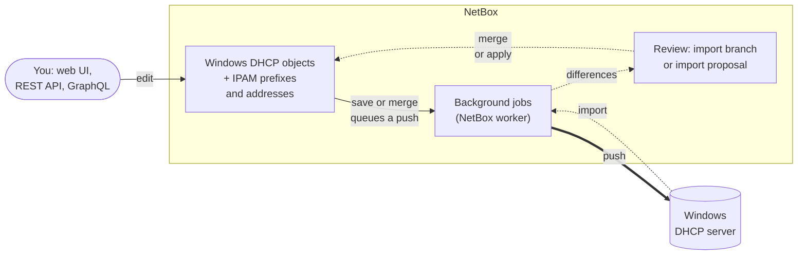

# netbox-windows-dhcp-plugin

A NetBox plugin that models Microsoft Windows DHCP servers in NetBox and keeps both in step, in both directions,
over WinRM or SSH.

!!! note "0.2.0: standalone"
    From 0.2.0 the plugin no longer needs netbox-plugin-dhcp: it holds the whole Windows DHCP configuration in its own
    models. Coming from 0.1.x, read [Upgrading from 0.1.x](installation.md#upgrading-from-01x) first: there is no data
    migration. Every v1 feature is built and tested against an in-memory fake server and PowerShell stubs. The Windows
    side (scripts, transports, sync rules) is that of 0.1.x, apart from option values now being lists. 0.1.0's lab tests
    ran in full against two Windows Server 2022 DHCP servers, over WinRM (HTTP and HTTPS) and SSH; release candidate
    testers ran Windows Server 2025. 0.2.0 passed the full lab tests on two Windows Server 2025 servers. Kerberos and
    SSH keys have not been tried on a real server yet (see [Limitations](limitations.md)). Try it on a lab server before
    a production one.

## What it does

The plugin models a Windows DHCP server the way Windows sees it: scopes, superscopes, reservations, exclusion
ranges, classes, option definitions and values, policies, failover relationships and MAC filters. Scopes and
reservations point at the core NetBox prefix, IP range, IP address and MAC address objects, so DHCP addresses show
up in IPAM too. It keeps that data and the real Windows servers in step:

- **Import** reads a Windows server and brings its configuration into NetBox for review. With
  [netbox-branching](https://github.com/netboxlabs/netbox-branching) each import is a branch you can review and
  merge; without it, each import is a list of proposed changes you apply or dismiss one by one.
- **Push** makes a Windows server match NetBox. With branching it runs when a branch is merged (so, with
  [netbox-change-control](https://github.com/antoinekh/netbox-change-control), only after an approved change);
  without branching it runs a few seconds after each save. A **dry run** shows what a push would change.
- **Leases** are read live from Windows and shown on a Leases tab of the scope page.

The thick arrow is a push (NetBox to Windows), the dotted ones an import (Windows to NetBox, through review).

The two directions never mix: a push only writes Windows, an import only writes NetBox, and what an import finds is
reviewed before it reaches NetBox's main data (unless you choose to import straight into main). All Windows I/O runs
in NetBox background jobs, never in a web request. Credentials live in the plugin configuration, never in the
database.

## What is covered

| | IPv4 | DHCPv6 |
|---|---|---|
| Scopes and their settings | yes | yes (/64) |
| Superscopes | yes | n/a |
| Exclusion ranges | yes | read, left alone |
| Reservations | yes | yes (DUID and IAID) |
| Option definitions | yes | standard options only |
| Option values (server, scope, reservation, user class, policy) | yes | yes, no policies |
| User classes | yes | yes |
| Vendor classes, their definitions and values | yes | read, left alone |
| Policies | yes | n/a (Windows has none) |
| Failover relationships | yes | n/a (Windows has none) |
| MAC filters and the allow and deny list switches | yes | n/a |
| Leases | live view | live view |

## Where to start

1. [Install](installation.md) the plugin.
2. [Prepare the Windows servers](windows-setup.md): an account, WinRM over HTTPS or OpenSSH.
3. [Configure](configuration.md) a credential profile.
4. Follow the [first sync](quickstart.md) walkthrough: add a server, test the connection, import, edit, push.

Then read [how objects map](mapping.md) between Windows and NetBox, and the [import](import.md) and [push](push.md)
pages for the rules that keep both sides safe.

## Compatibility

| Plugin | NetBox | netbox-plugin-dhcp | netbox-branching | netbox-change-control | Python |
|---|---|---|---|---|---|
| 0.2.x | 4.7 | not used | 1.2.2 or later (optional) | 0.6 or later (optional) | 3.12 to 3.14 |
| 0.1.x | 4.7 | 0.2.x (required) | 1.2.2 or later (optional) | 0.6 or later (optional) | 3.12 to 3.14 |

The 0.1.x line (latest 0.1.3) keeps getting bug fixes, but no new features, for installs that stay on
netbox-plugin-dhcp; see [Upgrading from 0.1.x](installation.md#upgrading-from-01x).

Windows Server 2016 or later with the DHCP Server role and its PowerShell module (`DhcpServer`).

## License

Apache-2.0.
