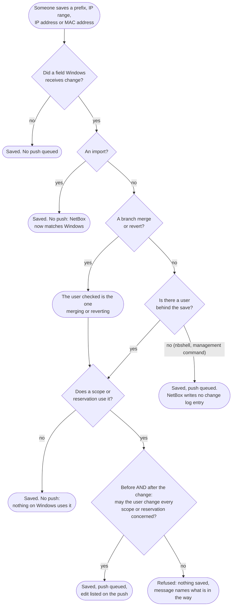

# Editing IPAM objects used by DHCP

A scope or reservation on Windows is built from objects that live in NetBox's IPAM and DCIM: a scope's subnet and
range come from a **prefix** and an **IP range**, a reservation's address and client from an **IP address** and a
**MAC address**. Editing one of those objects therefore changes Windows DHCP on the next push, even though nobody
touched the plugin's own pages.

Since 0.4.0, such an edit is treated as what it is: a DHCP change. It needs the plugin's permission on every scope or
reservation it affects, and every push records which edits it carried. This page explains the rule, what users see,
how to set up roles for it, and how to follow a change from NetBox to Windows.

!!! summary "In one paragraph"
    Changing a prefix, an IP range's start or end, an IP address or a MAC address that a scope or reservation uses
    needs `change` on that scope or reservation, on top of NetBox's own permission on the object. Without it, NetBox
    refuses the save and says which scope or reservation is in the way. Other fields (description, status, tags, VRF,
    DNS name...) never reach Windows and need nothing extra. Each push's sync run lists the edits it carried, with a
    link to the change log.

## Why

Two problems existed before 0.4.0:

- **Anyone with IPAM rights could change production DHCP.** In many organisations the IPAM team edits prefixes and
  addresses while another team runs the DHCP servers. A user with only `ipam.change_ipaddress` could renumber a
  reservation, or a user with `ipam.change_iprange` could shrink a scope, and Windows received the change seconds
  later, with no DHCP permission and no review.
- **No trail.** NetBox's change log showed the IPAM edit and the plugin showed a push, but nothing connected the two.
  Finding out why a reservation moved on Windows meant matching timestamps by hand.

## What counts as a DHCP change

A push reads exactly these fields of the core objects. Changing one of them, on an object a scope or reservation
uses, is a DHCP change:

| Object | Field | What Windows gets from it | Permission needed |
|---|---|---|---|
| Prefix | the prefix: network **and** length | the scope ID and subnet mask | `netbox_windows_dhcp_plugin.change_scope` on every scope using the prefix |
| IP range | start address, end address (the address part) | the scope's start and end of range | `netbox_windows_dhcp_plugin.change_scope` on every scope using the range |
| IP address | the address (the address part, not the mask) | the reservation's IP address | `netbox_windows_dhcp_plugin.change_reservation` on every reservation using it |
| MAC address | the MAC address | the reservation's client ID | `netbox_windows_dhcp_plugin.change_reservation` on every reservation using it |

This permission comes **on top of** NetBox's own permission on the object (`ipam.change_prefix`,
`ipam.change_iprange`, `ipam.change_ipaddress`, `dcim.change_macaddress`), which NetBox checks as usual.

Everything else on these objects never reaches Windows, so editing it needs no plugin permission and queues no push:

- status, role, tenant, VRF, site or location, description, comments, tags, custom fields;
- an IP address's DNS name, its assigned interface or device, its mask (`198.18.50.101/24` to `/32` keeps the
  address, which is all Windows gets);
- a MAC address written differently (`aa:bb:cc:00:00:01` and `AA-BB-CC-00-00-01` are the same MAC);
- anything on an object no scope or reservation uses.

The reservation's own name and description, the scope's name, lease time and options are fields of the plugin's
scope and reservation, edited on the plugin's pages, which already need `change_scope` or `change_reservation`.

Deleting a prefix, range, IP address or MAC address that a scope or reservation uses is not possible at all (NetBox
reports it as protected); delete or re-point the scope or reservation first.

## How the check works



Some details matter in practice:

- **Every** dependent object must pass. A prefix shared by scopes on two servers needs `change_scope` on both.
- **Failover partners share their IPAM objects.** When both servers import into the same VRF, a failover scope
  exists on both servers and both scopes point at the same prefix and IP range; each of its reservations exists on
  both, pointing at the same IP address and MAC address. Resizing such a scope needs `change_scope` on both servers'
  scopes, and renumbering a reservation or changing its MAC needs `change_reservation` on both reservations. A MAC
  address object is also shared by every reservation for that MAC, on any server.
- **Object permission constraints count**, and they are evaluated twice: against the values before the edit and
  against the values after it. A permission limited to part of a subnet therefore lets an address move inside that
  part but not out of it (see [Recipes](#recipes)).
- The check runs for every way a person can save: the edit form, bulk edit, CSV/JSON/YAML import (updates by `id`),
  the REST API (also `?background=true` requests), and custom scripts, which run as the user who started them (a
  script started by an event rule runs as the user whose change fired the rule). Of the four fields, NetBox's bulk
  edit can change only a prefix's length (the **Prefix length** field), which is checked like any other edit; it
  cannot change range bounds, addresses (only their mask, which does not count) or MAC addresses.
- A refused save is rolled back as a whole. In the UI the form comes back with the message; in a bulk edit or bulk
  import nothing of that request is saved, even the objects that would have passed; the REST API answers HTTP 400.

## What the user sees

### In the UI

The edit form comes back with an error, and nothing is saved:


The message names, for each scope or reservation in the way, the Windows server, the scope ID and (for a
reservation) the address, the way the plugin's pages show them, and the permission missing. For a user with no
reservation permission at all, both partners' reservations are named:

```text
Changing address would change reservation dhcp01/198.18.30.0/198.18.30.11 on Windows. You need the "change
reservation" permission on it. Changing address would change reservation dhcp02/198.18.30.0/198.18.30.11 on
Windows. You need the "change reservation" permission on it.
```

Scopes and reservations the user may not even view are **not named, nor counted**, so the message reveals nothing
about objects hidden from them beyond the fact that some exist:

```text
Changing address would change one or more reservations on Windows that you may not view. You need the "change
reservation" permission on them.
```

At most five visible objects are named; the rest are counted ("And 3 more.").

### In the REST API

```http
PATCH /api/ipam/ip-addresses/6/
{"address": "198.18.50.110/24"}
```

```http
HTTP/1.1 400 Bad Request
{"detail": "Changing address would change reservation dhcp01/198.18.50.0/198.18.50.101 on Windows. You need the \"change reservation\" permission on it."}
```

Bulk requests sent to the list endpoint with `?background=true` run as a job, as the same user: the job fails with
the same message (its error, and `data.detail` with `status_code` 400), and nothing of the request is saved.

### In a custom script

The save raises NetBox's `AbortRequest` with the same message. A script that does not catch it fails and, as
scripts run in a transaction, nothing it did is kept. A script that catches it carries on, but the refused object is
left as it was. A script run with **Commit changes** unticked is not checked (NetBox gives it no user context) and
saves nothing anyway.

## Recipes

Permissions are ordinary NetBox object permissions (**Admin > Authorization > Permissions**). The object types are
**Windows DHCP > scope** and **Windows DHCP > reservation**; the action is **change**.

### The DHCP team may renumber everything

Give the DHCP team's group `change` on scopes and reservations (they usually have it already as
[DHCP editors](permissions.md#suggested-roles)) plus NetBox's own `change` on prefixes, IP ranges, IP addresses and
MAC addresses. Nothing else to do.

### The IPAM team edits IPAM but must not touch DHCP

Give the IPAM team NetBox's `ipam` / `dcim` permissions and **no** `change` on the plugin's scopes and reservations.
They can still edit everything Windows does not receive (descriptions, statuses, DNS names, tags...) on all objects,
and create new prefixes and addresses. An edit that would change DHCP is refused and tells them which scope or
reservation is involved, so they can ask the DHCP team.

Give them `view` on scopes, reservations and Windows servers too, so the refusal can name the objects in the way.

### One team per Windows server (or site)

Constrain the permission to the server:

| Object type | Action | Constraint |
|---|---|---|
| Windows DHCP > reservation | change | `{"scope__server__name": "dhcp01"}` |
| Windows DHCP > scope | change | `{"server__name": "dhcp01"}` |

The team can renumber reservations and resize scopes that exist on `dhcp01` only. Scopes in a failover relationship,
and their reservations, share their prefix, range, addresses and MACs with the partner, so those edits also need the
permission for the partner server, for example `{"scope__server__name__in": ["dhcp01", "dhcp02"]}`.

### Part of a subnet only

Constraints can use the address itself:

| Object type | Action | Constraint |
|---|---|---|
| Windows DHCP > reservation | change | `{"ip_address__address__net_host_contained": "198.18.50.96/28"}` |
| Windows DHCP > scope | change | `{"prefix__prefix__net_contained_or_equal": "198.18.0.0/16"}` |

Because the check runs before and after the edit, a reservation inside `198.18.50.96/28` can move to another address
inside it, but not to `198.18.50.200`; a scope can be resized only while it stays inside `198.18.0.0/16`.

!!! warning "Constrain on what the guard checks"
    Base constraints on the server, the scope or the four fields above. A constraint on another field of a core
    object (for example `{"ip_address__tenant__name": "lab"}`) can be met by editing that field, which needs no
    plugin permission, before making the DHCP edit.

### Restoring the 0.3.x behaviour

Give every role that edits IPAM objects `change` on scopes and reservations. Their IPAM edits then reach Windows as
before; they still show on each push's trail.

## When the check does not apply

| Situation | Checked? | Why |
|---|---|---|
| Edit form, bulk edit (prefix length), bulk import, REST API, background API requests | yes | a user is behind the save |
| Custom scripts, also `manage.py runscript` and scripts started by event rules | yes | they run as a user (`runscript --user`, else the first superuser; for event rules, the user whose change fired the rule) |
| Scripts run with **Commit changes** unticked | no | NetBox gives them no user context; they save nothing |
| `nbshell`, other management commands | no | there is no user to check. NetBox writes no change log entry for such saves; the push lists an **Edit** with no user and no **Changes** link |
| Applying import proposal items, imports into a branch or main | no | they write what Windows already holds |
| netbox-branching merge and revert | yes | as the merging or reverting user, against main, see below |
| Merging an import branch: the import's own changes | no | they bring NetBox in line with Windows; edits added to the branch by hand are checked |
| netbox-branching sync | no | it copies into a branch edits already made on main |
| Creating a new prefix, range, address or MAC | no | nothing can use an object that did not exist |

### With netbox-branching

The check runs twice for a branch:

1. **Editing inside the branch**: as the user editing, against the scopes and reservations **the branch** holds.
2. **Merging (or reverting) the branch**: every replayed change to one of the four fields is checked again, as the
   **user who merges or reverts**, against the scopes and reservations **on main** at that moment, before and after
   the change. This covers a scope or reservation created on main after the branch was created, which the branch
   never saw.

The merging user is checked, not each change's author, so the same person is checked whatever the merge strategy
(netbox-branching's iterative strategy replays changes as their authors, squash as the merging user), and someone who
lost access since making an edit does not block the merge. The check covers the four IPAM fields only: creating,
changing or deleting scopes and reservations themselves in a branch is governed by branching's own rules, as for any
other object.

If the merging user lacks the permission, **nothing is merged**: netbox-branching rolls the merge back, the branch
stays ready to merge (a refused revert leaves it merged), and the merge job ends as errored with a message such as:

```text
Branch rename-nas cannot be merged or reverted by reviewer: Changing address would change reservation
dhcp01/198.18.50.0/198.18.50.101 on Windows. You need the "change reservation" permission on it.
```

With change control, this means whoever clicks **Merge** on a change request that touches DHCP-related IPAM objects
needs `change` on those scopes or reservations, as well as change control's own permission to merge. When change
control merges an approved request automatically, the user checked is the request's requester. A revert works the
same way, as the reverting user.

The push after a merge or revert is listed as triggered by it.

## Following a change from NetBox to Windows

Every push's sync run has a **Triggered by** panel listing why it ran:


Windows knows a reservation by its address, so renumbering one shows in the summary as a **delete** of the old
reservation and a **create** of the new one (name, client ID, description and options carried over), not as an
update.

| Source | Meaning | Details |
|---|---|---|
| Edit | an edit of a DHCP object, or of an IPAM object one uses | the user, and **Changes**: the change log entries of that request (`/core/changelog/?request_id=...`) |
| Sync now | someone clicked **Sync now** (or called `push` in the API) | the user |
| Branch merge | a netbox-branching merge | the merging user and the branch |
| Branch revert | a netbox-branching revert | the reverting user and the branch |

To trace a change on Windows back to NetBox:

1. Open the Windows server, tab **Sync runs**, and the push that applied the change (its summary lists what it
   created, updated and deleted on Windows).
2. In **Triggered by**, click **Changes** next to the edit: NetBox's change log shows every object that request
   saved, with before and after values and the user.
3. If that push lists no edit for the change, look at the run before it for the same server: a failed push, or a
   push that was already running when the edit was made, keeps the entry. An edit with no user and no **Changes**
   link came from `nbshell` or a management command, which NetBox does not record in its change log.

Which edits land on which push:

- Edits are pushed after the `push_debounce` delay. Edits made while a push **is still waiting to start** are added
  to that push, so several people's edits can share one sync run, each listed.
- Edits made **once a push has started** are listed on the next push, even if the running one already carried them
  (it reads NetBox after it starts).
- A push that **fails** keeps its list. Nothing retries it automatically: the push that later applies the change
  (**Sync now**, or the next edit's push) lists only its own trigger, so look for the edit on the failed run.
- Several saves of one request share one entry, and so do repeated **Sync now** clicks by one user, or saves made
  without a request (an `nbshell` loop), while the push waits. The panel shows the first 50 entries and counts the
  rest; the REST API lists them all.
- A push that finds **sync disabled** on its server does nothing and drops its list; edits made while sync is
  disabled are not recorded.
- Dry runs never take the list.

The REST API returns the same list as `triggers` on each sync run (`/api/plugins/windows-dhcp/sync-runs/<id>/`):

```json
"triggers": [
  {
    "source": "edit",
    "user": "ipam-only",
    "request_id": "4f0c2b9e-7d4f-4a3e-9a51-0f6d3f2b8c11",
    "branch": "",
    "created": "2026-11-15T19:12:04.512311+00:00"
  }
]
```

## Try it yourself

On a test system with a Windows server imported:

1. Create a user `ipam-only` with `view` and `change` on IP addresses, prefixes, IP ranges and MAC addresses,
   `view` on Windows servers, scopes, reservations and sync runs, and `view` on **Core > object change** (to follow
   the **Changes** link in step 5).
2. As `ipam-only`, edit the IP address of a reservation and change the address: refused, the message names the
   reservation.
3. Change only its description: saved, and no push appears on the Windows server.
4. As an admin, give `ipam-only` `change` on reservations with the constraint `{"scope__server__name": "<server>"}`.
5. Repeat step 2: saved. After the debounce a push runs; its sync run shows **Triggered by: Edit, ipam-only**, and
   **Changes** opens the change log of that edit. On Windows, the reservation has the new address.
6. Try the same on a reservation of another server, or of a failover scope: still refused, the message names the
   reservation the constraint does not cover.

## Troubleshooting

**"I only changed the description and got refused."** A description alone is never checked, so the same save
changed one of the four fields too: compare the address (or prefix, range bounds, MAC) in the form with the saved
object. The mask of an IP address does not count.

**"The message says one or more reservations that you may not view."** Scopes or reservations you may not view
depend on the object. Ask an administrator for `view` on them (to see which) or for `change` (to make the edit).

**"The same IP address needs two reservation permissions."** The address is used by a failover scope: each partner
server has its own reservation pointing at it. You need `change_reservation` on both. The same goes for the prefix
and range of a failover scope (`change_scope` on both scopes) and for a MAC address used by several reservations.

**"A script that worked before 0.4.0 now fails."** Scripts run as the user who started them; give that user the
plugin permission, or run the change as a user who has it.

**"An import changed an address without the permission."** By design: imports write what Windows already holds.

**"The merge job failed: Branch ... cannot be merged or reverted by ..."** A change in the branch would change a scope
or reservation on main that the merging user may not change (perhaps one created on main after the branch was made).
Nothing was merged. Merge as a user who has the permission named in the message, or ask an administrator for it.

**"The merge is refused for a reservation the branch deletes or creates anyway."** With the iterative merge strategy,
changes are replayed in the order they were made and each is checked against main as it stands at that point: an
address edited before its reservation is deleted, or edited after the reservation was created in the same branch,
is checked against that reservation. The squash strategy applies deletes first and creates last, so it does not
refuse these.

**"A push ran after a merge, although the branch only changed descriptions."** Direct edits of fields Windows does
not receive queue no push, but a merge queues one push per server it touches. That push finds nothing to change.

**"I want to delete an IP address but NetBox says it is protected."** A reservation uses it. Delete the reservation,
or point it at another address, first.

## Upgrading to 0.4.0

The rule refuses edits that 0.3.x accepted. Before upgrading, list the roles that renumber prefixes, ranges, addresses
or MAC addresses used by DHCP and decide, per role, whether they keep that power (grant `change` on scopes and
reservations, with constraints if needed) or lose it (do nothing). Migration `0004` adds the table behind the
**Triggered by** panel; it needs nothing from you.
