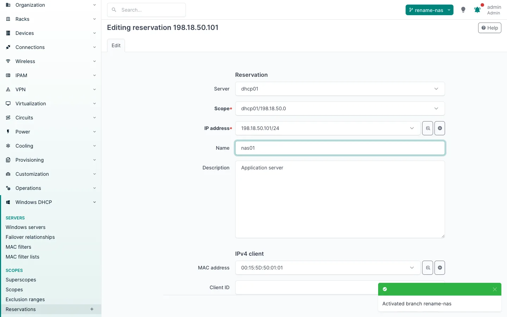
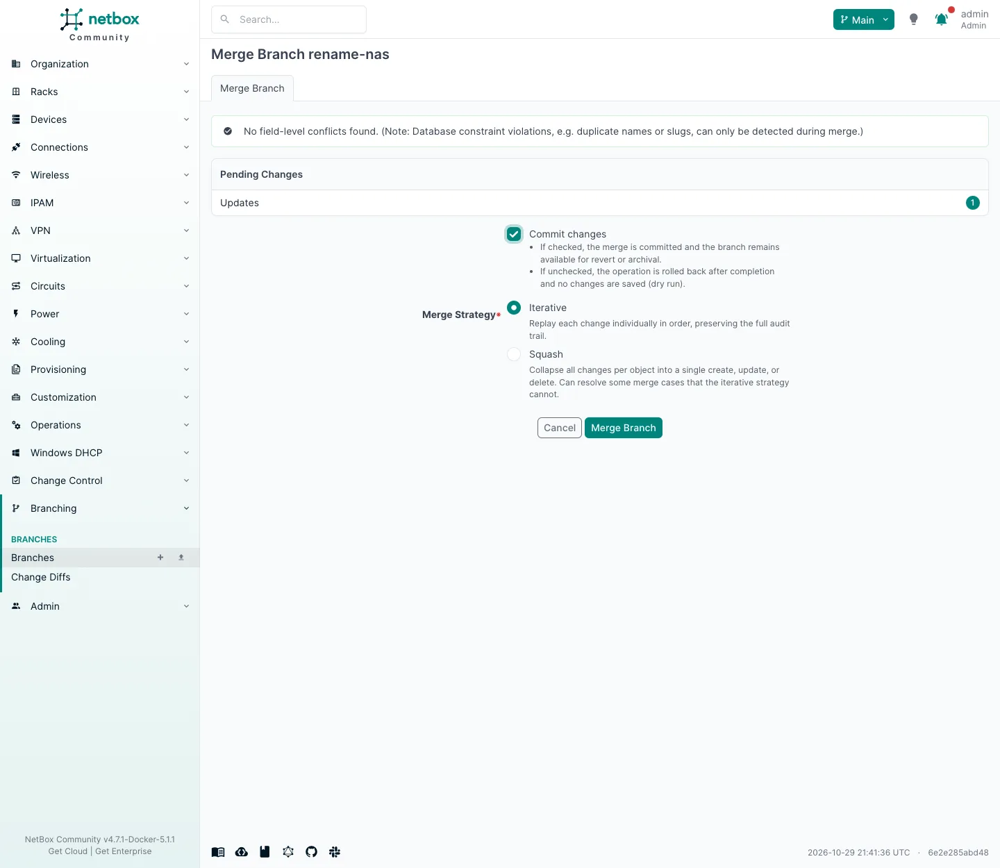
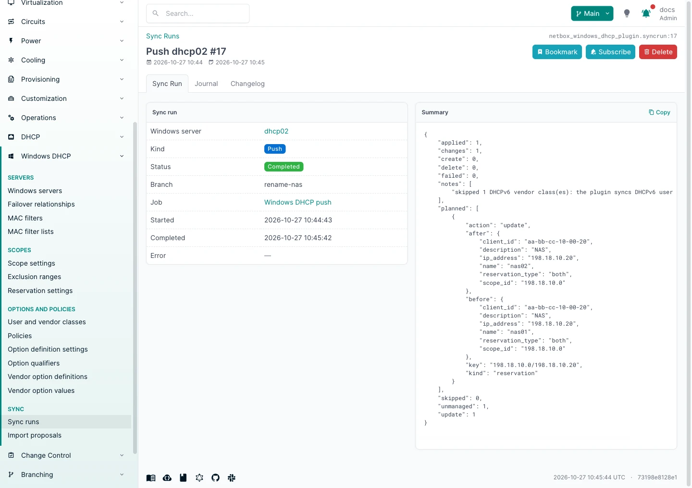
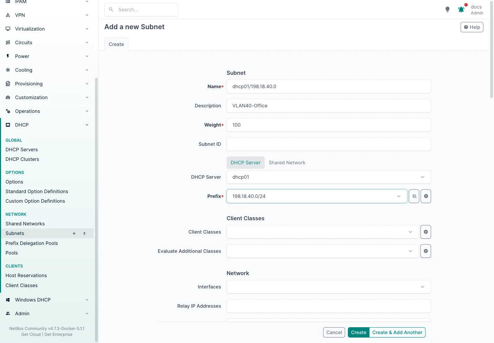
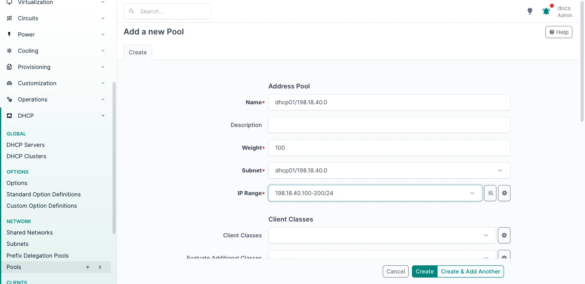
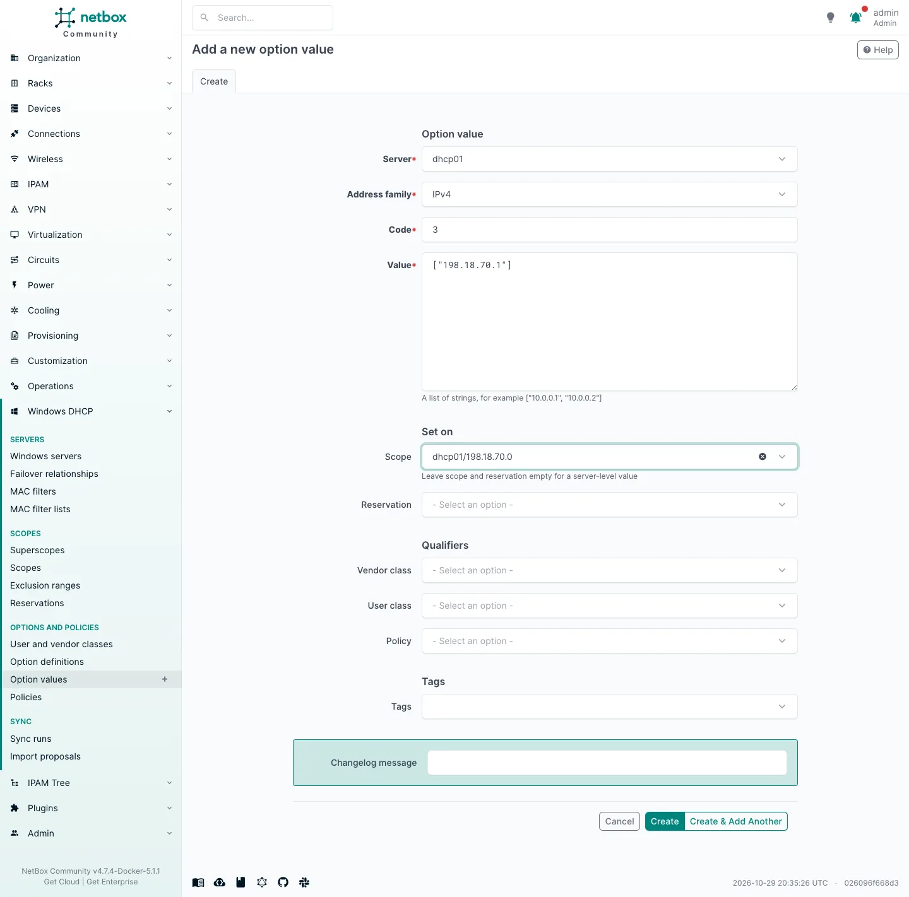
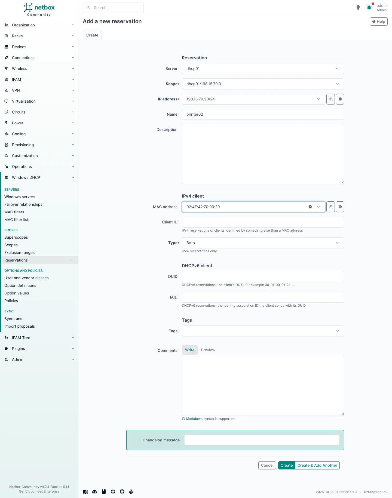
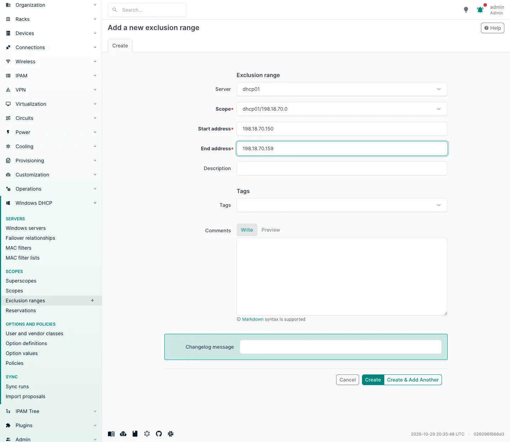
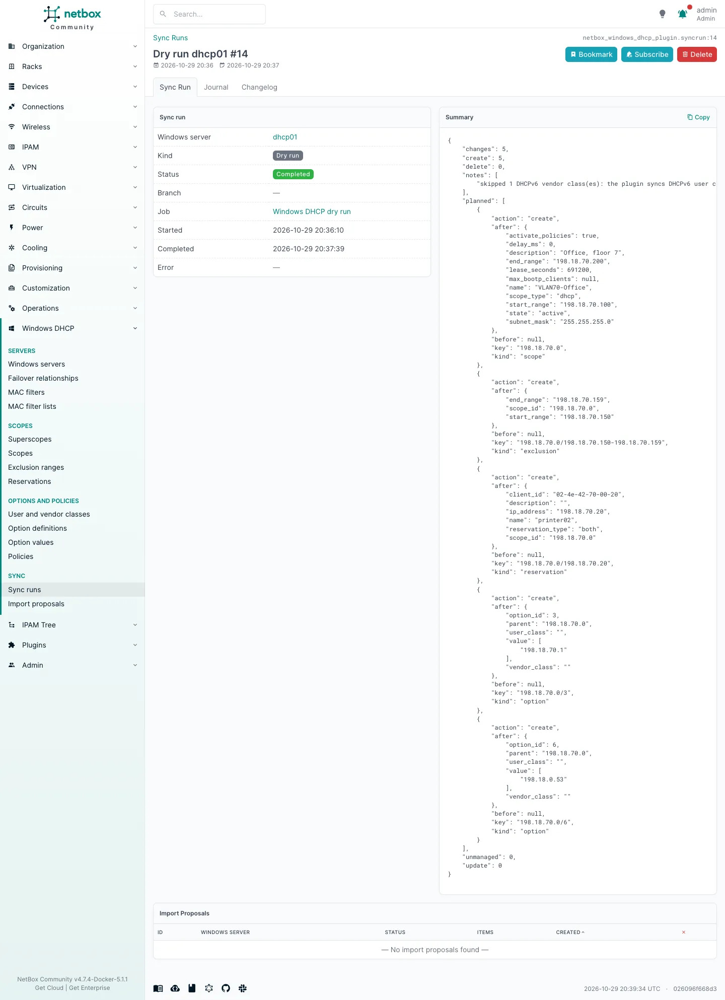
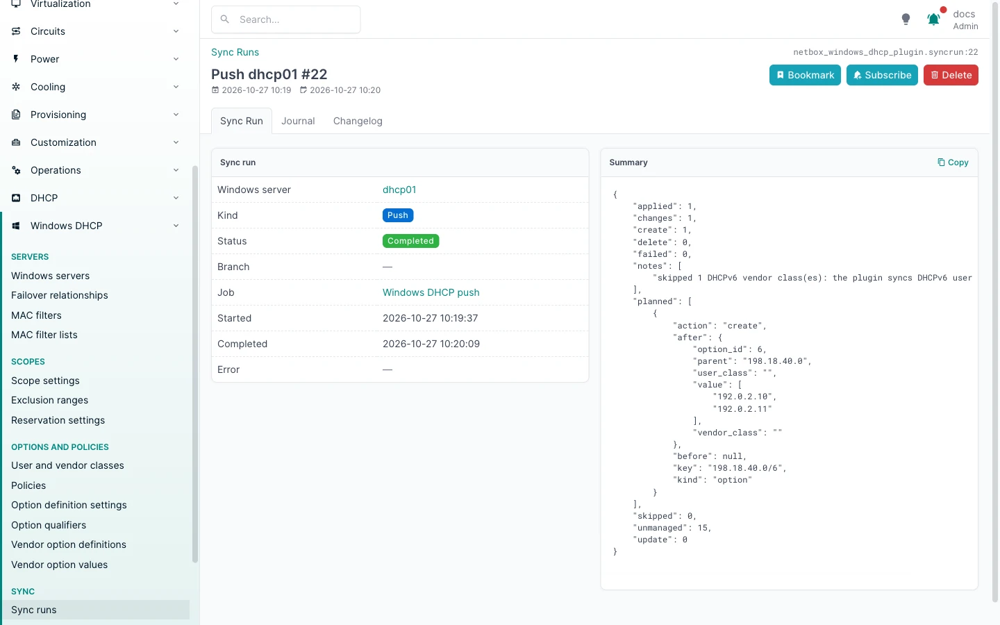

# Push to Windows

A push makes one Windows server match NetBox. It is a **reconcile**, not a replay of the change log: it reads the
whole Windows configuration, compares it with what NetBox holds for the server, and creates, updates and deletes what
differs, in dependency order. So a push started for one changed reservation also fixes anything else that drifted,
within the [safety rules](#what-a-push-will-not-do).

## When a push runs

| Setup | What queues a push |
|---|---|
| With netbox-branching | Merging or reverting a branch: one push per Windows server the branch touched. Edits made directly in main push as without branching, except while a branch is being merged or reverted (the merge queues its own pushes). Edits inside a branch push nothing until it is merged |
| With change control as well | The same; change control only allows a merge once its change request is approved, so a push always follows an approved change |
| Without branching | Every save or delete of a DHCP object: one push per affected server, `push_debounce` seconds (10) after the change is committed, so a burst of edits becomes one push |
| Always | **Sync now** on the Windows server page, or the REST action |

Nothing is pushed while **Sync enabled** is off on the Windows server. Turning it on does not push the changes made in the
meantime by itself: run a dry run to see them, then **Sync now**.

A change affects a server when it touches one of its sys4 subnets, pools, reservations, options or option
definitions, one of the plugin's objects for it, or a prefix, IP range, IP address or MAC address one of those points
at. Moving a subnet from one server to another pushes both. Applying import proposal items does not push.

A push queued while another for the same server is still waiting to start is not queued twice: the waiting one reads
the latest NetBox data anyway.

With netbox-branching, edit inside a branch, then merge it (after approval, with change control). The merge queues
the push, and its sync run names the branch:

## Dry run

**Dry run** on the Windows server page plans a push without writing anything. Its sync run summary lists the
planned changes (`planned`, with the Windows key and values of each) and the refused ones (`not_pushed`, with the
reason). It works with sync disabled, so it is the way to check a server before turning sync on.

## Example: a new scope from NetBox

A Windows scope is a sys4 subnet with a pool, as [How objects map](mapping.md#scopes-ipv4) describes. To add one to
`dhcp01`:

1. **IPAM**: the prefix (`198.18.40.0/24`) and the IP range of the pool (`198.18.40.100` to `198.18.40.200`) exist.
2. **DHCP > Subnets > Add**: name, DHCP server, prefix. The **description** becomes the Windows scope name, the
   **comments** its description (set them through the API for now, see
   [How objects map](mapping.md#names)), and the **valid lifetime** its lease duration.

    

3. **Add Object > Pool** on the subnet, with the IP range: the scope's start and end.

    

4. **Add Object > Option** for scope options, for example the router (option 3).

    

5. **Add Object > Host Reservation** for reservations: the IP address and MAC address objects, and the
   **description**, which becomes the Windows reservation name.

    

6. **Windows DHCP > Exclusion ranges > Add** for what Windows should not hand out.

    

7. **Dry run** on the Windows server shows what the push will create; then **Sync now** (or, with sync enabled, just
   wait: each save queues a push).

    

    Windows checks some values when they arrive: here it refused DNS servers that do not answer DNS (option 6), the
    push applied the other four changes and named the refused one (see
    [Troubleshooting](troubleshooting.md#push)). With the option corrected in NetBox, the next push sent it:

    

## Order

Creates and updates run parents first: classes, option definitions, scopes, superscopes, exclusion ranges,
reservations, policies, option values, failover relationships, MAC filters, list switches (IPv4 and DHCPv6 kinds
side by side). Deletes run in the reverse order. Changes run one at a time.

Policies are created and updated level by level (the server, then each scope) in ascending **processing order**,
whatever their names. Windows numbers the policies of a level 1, 2, 3... without gaps: it refuses a number past the
end (error DHCP 20110, for example order 2 when the scope has no policy yet), and a policy given a number already in
use moves the others down. A policy NetBox did not change that an insert moves down (one below a policy created by
hand, for example) is set back to its number in the same push, so it shows as a processing order update in the
plan.

NetBox does not renumber the other policies when one is deleted, but Windows closes the gap: delete order 1 of three
and Windows holds the other two as 1 and 2 while NetBox still says 2 and 3. Order 3 no longer fits, and moving the
other policy alone would put it below the third one, so the push leaves every policy at that level as it is (the
delete itself still runs) and lists them under **Not pushed** until you renumber them 1, 2, 3... in NetBox. An
import proposes the same renumbering. That Windows closes the gap on a delete, and renumbers on an update the way it
does on a create, has not been checked on a real server yet (see [Limitations](limitations.md)).

A reservation update keeps the reservation's option values. Windows Server 2025 was seen dropping them when a
description change was sent with the client ID and type (#42), so the push sends the client ID and type (DHCPv6:
DUID and IAID) only when they change, and after each reservation update it puts back any of the reservation's option
values that went missing. This adds no line to the plan or the dry run. If a value cannot be put back, the
reservation update counts as failed and names each option it lost. The next push recreates a lost value only if
NetBox holds it. Values NetBox does not hold, such as DHCPv6 vendor class values, option codes the plugin does not
sync, or values added on Windows since the last import, never come back by themselves (an import cannot see them
either, once Windows has dropped them): put them back by hand. The error says which kind each lost value is.

When a change fails, the push goes on with the others but skips the children of an object it could not create, and
keeps the parents of an object it could not delete. The run then ends **failed**, with one line per error. A lost
connection stops the run; the changes not attempted are listed.

## Managed objects

A push only deletes Windows objects that NetBox **manages**. The plugin keeps a record (**sync state**) of each
Windows object it manages, with a fingerprint of its values when it was last pushed (for a policy, everything but
its processing order, which Windows changes by itself when another policy is added or removed). An object becomes
managed when:

- a push creates or updates it;
- a push finds it identical on both sides (it adopts it, which is how objects merged from an import branch become
  managed);
- an import proposal item for it is applied.

Objects created by hand on Windows are not managed: a push leaves them alone (they count as `unmanaged` in the
summary), and they come into NetBox with the next import.

## What a push will not do

A push never touches Windows objects NetBox does not manage: it leaves them alone and only counts them (`unmanaged`).
Other refusals happen at two moments.

### Refused when the push is planned

These show in `not_pushed`, with the reason, in the dry run as well as the push. The push goes on with the rest and
the Windows object is kept as it is.

**Deletes that could lose data:**

- a managed object whose Windows values changed since the last push (someone edited it by hand). Delete it on
  Windows, or import it back;
- an object whose removal would take unmanaged objects with it: a scope holding a reservation, policy, vendor class
  value or option value made by hand on Windows, or anything the plugin does not sync (for example DHCPv6
  exclusions).

**NetBox data Windows cannot hold:**

- a scope (IPv4 subnet) without a pool, or a DHCPv6 subnet that is not a /64;
- a reservation without a MAC address or client ID, or a DHCPv6 reservation without an address, a DUID or an IAID;
- an option without a value, options 1 and 51 (they come from the prefix and the valid lifetime), values of codes
  Windows has no definition for, and a definition of a code Windows defines itself;
- two NetBox objects for one Windows object (two subnets on one prefix, two copies of an option);
- a policy without criteria, two policies with the same processing order, a policy whose processing order would
  leave a gap at its level (order 3 where Windows would only hold two policies, counting those made by hand), the
  other policies of that level when the policy is already on Windows (see above), or a policy option value whose
  policy NetBox does not hold at the same level;
- a superscope or failover relationship without scopes, a failover relationship whose partner has no Windows server
  in NetBox, or a hot standby relationship without the primary server's role;
- DHCPv6 vendor classes, and a DHCPv6 option value with a policy (Windows has no DHCPv6 policies).

### Refused while pushing

These are only found when the push reaches the change, so **a dry run does not show them**: it lists them as
ordinary planned updates or deletes. The push refuses the change, goes on with the others, and the run ends
**failed** with the reason in its `errors`.

- Changes Windows only allows by removing the object with everything in it: a scope's subnet mask (the prefix length
  in NetBox), an option definition's type or array flag, removing a policy condition, a failover relationship's
  partner. Make them on Windows by hand, then import.
- A hot standby relationship's role (active or standby), which Windows only sets when the relationship is created:
  delete it in NetBox and push, then create it again (see [Failover](failover.md#how-it-syncs)).
- Policy conditions and contents Windows refuses: a wildcard anywhere but at the start or the end of a condition
  value, and IP ranges (DHCP 20135) or ordinary option values (DHCP 20136) on a policy with an FQDN condition.
- Turning failover message authentication on with a profile whose `allowed_hosts` does not cover both partners.
  Without a shared secret profile, a push leaves authentication as Windows has it (on or off).

A scope range that moves one end out and the other in is set in two calls, since Windows refuses it in one (DHCP
20023): first the addresses both pools share, then the new range. When the old and new pools do not overlap at all,
the pool covers both for a moment, so exclude any static addresses between them first. If the second call fails,
the push tries to put the old range back.
- Deleting a scope with active leases: Windows refuses it (error DHCP 20007), and the plugin never forces it. Its
  managed reservations and values are removed first; the scope itself goes on a later push, once its leases have
  expired.

## Windows spelling

The push writes values back the way Windows expects them: `Active` and `InActive`, durations as `d.hh:mm:ss`,
4294967295 for "no BOOTP limit", MAC addresses as `00-15-5d-01-02-03`. Values left empty in NetBox where Windows
always has one (a lease time, DHCPv6 lifetimes) keep the Windows value, so they do not show as a change on every
push.

## Failover

After pushing to the primary server of a failover relationship, the push replicates the changed scopes to the
partner. A replication that fails is retried by the next push to the primary. See [Failover](failover.md).
