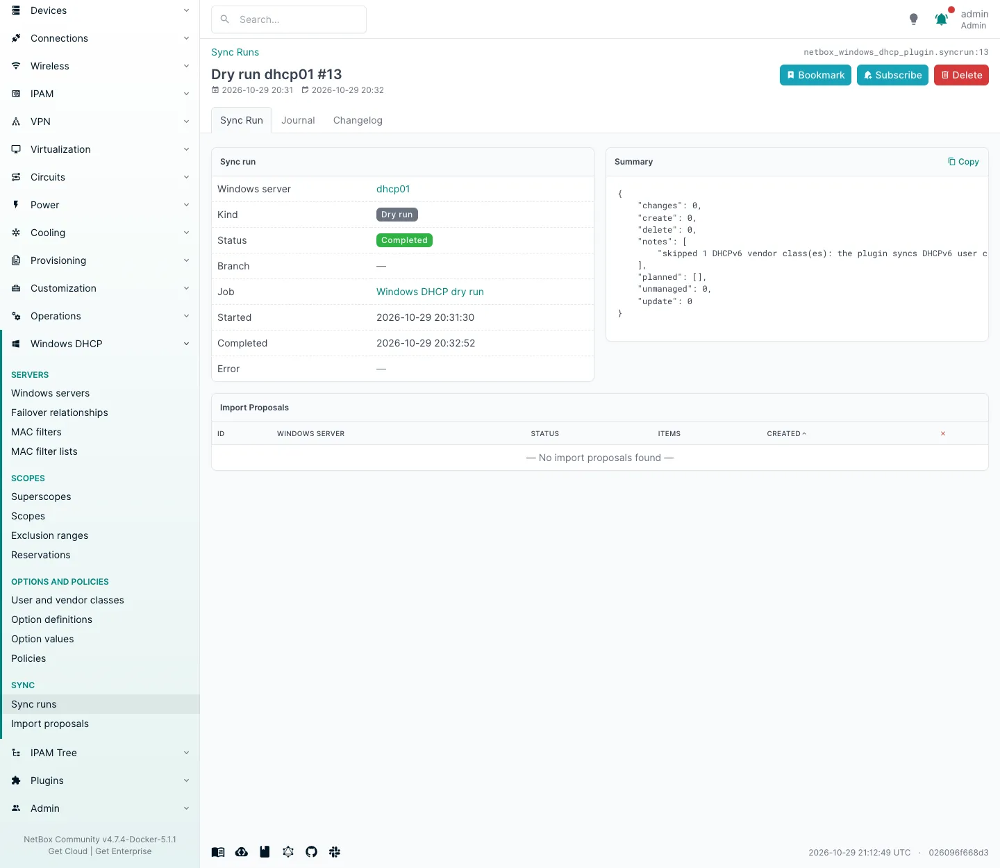

# First sync

This walkthrough connects one Windows DHCP server, imports its configuration, changes something in NetBox and pushes
it back. It assumes the plugin is [installed](installation.md), the server is [prepared](windows-setup.md) and a
[credential profile](configuration.md#credential-profiles) called `dhcp-admin` exists.

Use a lab server the first time. The import only writes to NetBox, but the push writes to Windows.

## 1. Add the Windows server

**Windows DHCP > Windows servers > Add**:

| Field | Value |
|---|---|
| Name | `dhcp01`: the server's name in NetBox. Pick a short, stable one |
| Device, Virtual machine | optional, one or the other: the machine the DHCP service runs on, for reference |
| Host | `dhcp01.corp.example` (must be covered by the profile's `allowed_hosts`) |
| Transport | WinRM |
| Credential profile | `dhcp-admin` |
| WinRM authentication | NTLM |
| WinRM over HTTPS, Verify host | ticked |
| Import VRF | the VRF the scopes' prefixes belong in (empty for global) |
| Sync enabled | **untick it for now**, so nothing is pushed until you have looked at a dry run |
| Import interval | empty (no scheduled imports yet) |

See [Windows servers](servers.md) for every field.


The screenshots on this page come from a lab: WinRM over HTTP with CredSSP, which a lab profile allows with
`allow_insecure_credssp`. Use HTTPS in production.

## 2. Test the connection

Open the Windows server and click **Test connection**. It queues a job; the **Sync runs** table at the bottom of the
page shows the result after a few seconds. A completed run says how many IPv4 scopes the server holds. A failed run
says why; see [Troubleshooting](troubleshooting.md#connection) for the usual causes.


**Reported names** are the names and addresses the server gave for itself. Failover partners are matched on them
(see [Failover](failover.md#the-model)).

## 3. Import

Click **Import now** (with netbox-branching: **Import > Import into branch**).

- **With netbox-branching**, the job creates a branch named `dhcp-import/dhcp01/<timestamp>` and writes everything it
  found into it. With netbox-change-control it also opens a change request. Open the branch, review its diff, and
  merge it (after approval, with change control).
- **Without branching**, the job opens an **import proposal** (**Windows DHCP > Import proposals**). Each row is
  one object to create, update or delete, with before and after values. Click **Apply all**, or select rows and
  click **Apply selected**.

The sync run of the import gives the number of differences and notes on anything left out (for example DHCPv6
vendor classes, which the plugin does not sync).


You now have a scope for every Windows scope, with its reservations, exclusion ranges and option values, plus the
server's classes, option definitions, policies and the rest (see [How objects map](mapping.md)). The prefixes, IP
ranges, IP addresses and MAC addresses they point at are in IPAM, in the server's import VRF.

## 4. Dry run

Click **Dry run** on the Windows server. Right after an import nothing should be planned: the sync run summary shows
`changes: 0`. An import and a push must agree; if the dry run plans changes, read its `planned` and `not_pushed` lists
and see [Troubleshooting](troubleshooting.md#a-dry-run-right-after-an-import-plans-changes).



## 5. Turn on sync and change something

Edit the Windows server and tick **Sync enabled**. Then change something small, for example the name of a
reservation (**Windows DHCP > Reservations**):

- **Without branching**, save it. About `push_debounce` seconds later (10 by default) a push job runs and changes
  the reservation on Windows.
- **With branching**, make the change in a branch and merge it. The merge queues the push.

The push's sync run lists what it applied, with the values before and after:


Check on Windows:

```powershell
Get-DhcpServerv4Reservation -ScopeId 10.1.0.0
```

## 6. What next

- Set an **Import interval** so changes made on Windows come back to NetBox, and set `import_user` if you use
  branching (see [Import](import.md#scheduled-imports)).
- Read [Push](push.md) for what a push will and will not delete.
- Give your team the [permissions](permissions.md) they need.
