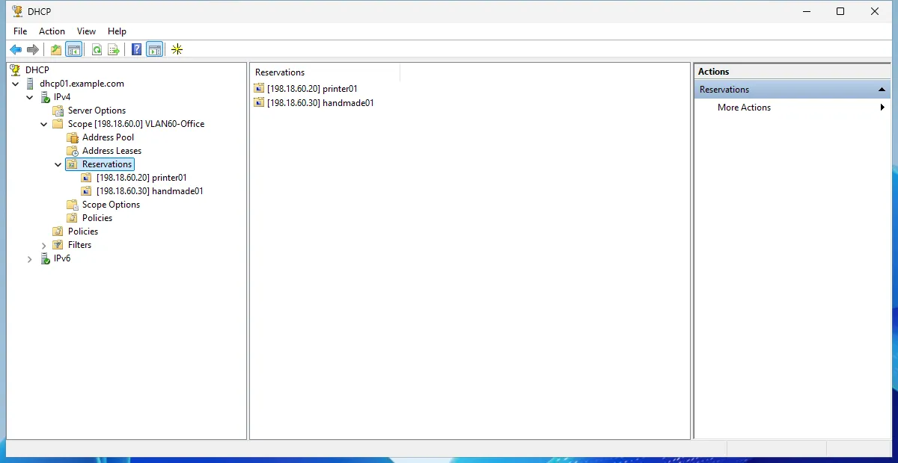

# Reservations

A DHCP reservation gives one client, known by its MAC address, the same IPv4 address every time. In NetBox it is a
**Reservation** (**Windows DHCP > Reservations**) in a Windows scope; the plugin pushes it to the Windows server and
keeps the two in step. This page walks through creating one, changing it, giving it options and deleting
it, with what Windows shows after each push. To do the same from a script, see
[Reservations through the API](reservations-api.md).

The screenshots come from a lab: NetBox without branching, two Windows Server 2025 DHCP servers known to NetBox as
`dhcp01` and `dhcp02` (hosts `dhcp01.example.com` and `dhcp02.example.com`), with **Sync enabled** on both, so every
save queues a push. With netbox-branching, make the same changes in a branch: the push runs when the branch is merged
(see [Push to Windows](push.md#when-a-push-runs)). Without sync enabled, click **Dry run** and then **Sync now** on the
Windows server after each change.

## Before you start

- The scope exists in NetBox and on Windows (see
  [Example: a new scope from NetBox](push.md#example-a-new-scope-from-netbox), or import an existing scope). Here
  the scope is `198.18.60.0/24`, named `VLAN60-Office` on Windows.
- The reservation points at an IP address (here `198.18.60.20/24`) and a MAC address (here `02:4E:42:60:00:20`).
  Pick existing ones in the form, or create them from it: the **+** button next to each field opens NetBox's own
  IP address or MAC address form in a pop-up and selects the new object when you save it.

## Create a reservation

**Windows DHCP > Reservations > Add**:

| Field | Value | On Windows |
|---|---|---|
| Server | optional, only narrows the scope list | the server |
| Scope | the scope | the scope |
| IP address | the reserved address, inside the scope's prefix | the IP address |
| MAC address | the MAC address | the client ID |
| Client ID | empty (only for clients identified by something else than a MAC address) | the client ID |
| Name | `printer01` | the reservation **name** |
| Description | optional | the reservation **description** |
| Type | DHCP, BOOTP or Both (the default) | the supported types |

MAC address, client ID and type sit under **IPv4 client**; DUID and IAID, under **DHCPv6 client**, are for DHCPv6
reservations (see [DHCPv6](dhcpv6.md)). Windows matches a reservation on its client, so an IPv4 reservation needs a
MAC address or a client ID (one of the two), and a DHCPv6 one a DUID and an IAID: NetBox refuses to save it without
them. A scope holds one reservation per IP address.

Saving queues a push to the Windows server. Its sync run (**Windows DHCP > Sync runs**, or the **Sync runs** table
on the Windows server) lists what it planned and applied: one reservation created, with type `both`, the default.


The note about a DHCPv6 vendor class is about the vendor class Windows ships with; the plugin syncs DHCPv6 user
classes only and leaves it alone.

On the Windows server, the DHCP console shows the reservation under the scope:


## Reservation type (DHCP, BOOTP or both)

Windows reservations answer DHCP clients, BOOTP clients or both. The reservation's **Type** says which;
**Both** is the Windows default. To change it, edit the reservation and pick the type:

## Reservation options

Option values on a reservation override the scope and server values for that one client. **Windows DHCP > Option
values > Add**: the server, the address family, the code, the value as a list of strings and, under **Set on**, the
reservation (its scope is filled in from it). Here option 15 (DNS domain name), value `["print.example.com"]`.

Here the two saves above went out in one push, as saves made close together do: the reservation updated from `both`
to `dhcp`, and the option value created on it.


Windows shows the reservation with its type DHCP:


The same check in PowerShell:

```text
PS> Get-DhcpServerv4Reservation -ScopeId 198.18.60.0 | Format-List

IPAddress   : 198.18.60.20
ClientId    : 02-4e-42-60-00-20
ScopeId     : 198.18.60.0
Name        : printer01
Type        : Dhcp
Description :
```

Windows also shows the reservation's options. The console also lists the values the reservation inherits from the
scope (003 Router here); only 015 belongs to the reservation:


```text
PS> Get-DhcpServerv4OptionValue -ReservedIP 198.18.60.20

OptionId   Name            Type       Value                VendorClass     UserClass       PolicyName
--------   ----            ----       -----                -----------     ---------       ----------
15         DNS Domain Name String     {print.example.com}
```

## Change a reservation

Edit the reservation (or its MAC address or option values) in NetBox; the next push updates Windows. A changed
name renames the reservation on Windows. An update keeps the reservation's option values: the push sends the client
ID and type only when they change, and puts back any option value Windows drops (see
[Push to Windows](push.md#order)).

## Delete a reservation

Delete the reservation in NetBox (its option values go with it; the IP and MAC address objects stay in NetBox). The
next push removes it from Windows, as long as NetBox manages it (the plugin created it, adopted it or imported it).
A reservation made by hand on Windows is never deleted by a push: it counts as **unmanaged** and comes into NetBox
with the next import.

In this example a second reservation, `camera01` at `198.18.60.21`, was created from NetBox and pushed, and a third,
`handmade01` at `198.18.60.30`, was added on Windows with `Add-DhcpServerv4Reservation`. Deleting `camera01` in
NetBox gave this push:


`camera01` is gone from Windows; `handmade01` stays:



## Reservations in a failover scope

When the scope belongs to a failover relationship, edit its reservations on the relationship's primary server in
NetBox. The push writes them to the primary and then replicates the scope to the partner; see
[A working failover, step by step](failover.md#a-working-failover-step-by-step).
